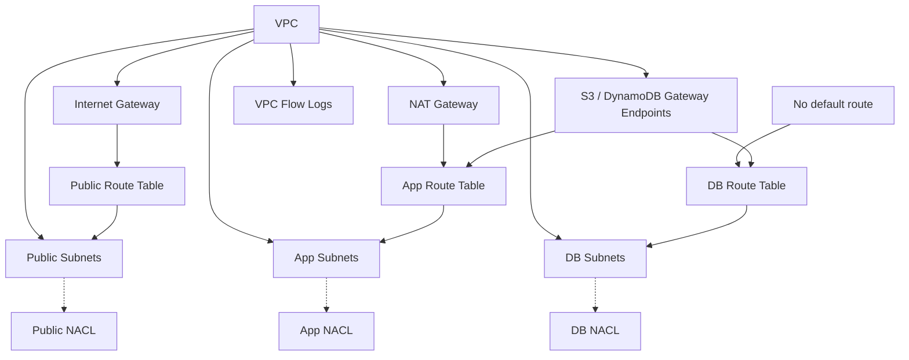

# Network Module

## Overview
This Terraform module provisions a foundational AWS network layout:

* **VPC** with DNS support/hostnames enabled.
* **Default security group** locked down (no ingress/egress) – satisfies **CKV2_AWS_12**.
* **Internet Gateway** for public internet access.
* **Regional NAT Gateway** (public) for app-tier outbound traffic.
* **Public subnets** (one per AZ, configurable CIDRs) – no auto‑assign public IP.
* **Private subnets** split into **app** and **db** tiers, one per AZ per tier.
* **Per-tier route tables**:
  * public → Internet Gateway
  * app → NAT Gateway
  * db → **no default route** (local routes plus gateway VPC endpoints only)
* **Gateway VPC endpoints** for S3 and DynamoDB (default), attached to every private route table.
* **VPC flow logs** to CloudWatch Logs (toggleable, enabled by default in the root config), encrypted with a dedicated KMS key and retained for 365 days by default.
* **Network ACLs** for public, app, and db tiers. Rule maps default to empty (deny all); the root config supplies the rules.

The module is designed to be reusable across environments and projects. All subnet, route-table, NACL, and rule resources use `for_each` with stable keys (never list indexes), so adding or reordering subnets does not churn resource addresses.

## File Structure
* `vpc.tf` – VPC, default security group, internet gateway, and NAT gateway.
* `subnets.tf` – Subnet locals and public/private subnet resources.
* `route_tables.tf` – Per-tier route tables, standalone routes, and subnet associations.
* `nacls.tf` – Network ACLs, per-subnet associations, and rules (variable-driven via `nacl_static_rules` and `nacl_dynamic_rules`).
* `endpoints.tf` – Gateway VPC endpoints (S3, DynamoDB).
* `flow_logs.tf` – Optional VPC flow logs, their KMS key, and delivery IAM role.
* `variables.tf`, `outputs.tf`, and `versions.tf` – Module inputs, outputs, and version constraints.

## Usage
```hcl
module "network" {
  source = "./modules/network"

  project                    = var.project
  vpc_cidr_block             = var.vpc_cidr_block
  public_subnet_cidr_blocks  = var.public_subnet_cidr_blocks
  private_subnet_cidr_blocks = var.private_subnet_cidr_blocks
  availability_zones         = var.availability_zones

  enable_flow_logs         = true
  flow_logs_retention_days = 365
  gateway_vpc_endpoints    = ["s3", "dynamodb"]

  # Optional: extra tags merged into every resource
  # tags = { Owner = "platform" }

  # Optional: NACL rules (default empty = deny all)
  nacl_static_rules  = var.nacl_static_rules
  nacl_dynamic_rules = var.nacl_dynamic_rules
}
```

`public_subnet_cidr_blocks`, `private_subnet_cidr_blocks.app`, and `private_subnet_cidr_blocks.db` must each contain **exactly one CIDR per availability zone**. The module fails validation otherwise, and all subnet CIDRs must be unique.

## Inputs
| Name | Type | Description | Default | Required |
|------|------|-------------|---------|:--------:|
| project | `string` | Project name used as prefix for all resources. | `"school-web"` | no |
| tags | `map(string)` | Extra tags merged into every resource. | `{}` | no |
| vpc_cidr_block | `string` | CIDR block for the VPC. | `"10.0.0.0/16"` | no |
| public_subnet_cidr_blocks | `list(string)` | CIDR blocks for public subnets (one per AZ). | `["10.0.1.0/24","10.0.2.0/24"]` | no |
| private_subnet_cidr_blocks | `object({app=list(string), db=list(string)})` | CIDR blocks for private subnets per tier (one per AZ per tier). | — | **yes** |
| availability_zones | `list(string)` | AZ names to distribute subnets. Update when `region` changes. | `["ap-southeast-1a","ap-southeast-1b"]` | no |
| enable_flow_logs | `bool` | Create VPC flow logs delivered to CloudWatch Logs. | `false` | no |
| flow_logs_traffic_type | `string` | `ALL`, `ACCEPT`, or `REJECT`. | `"ALL"` | no |
| flow_logs_retention_days | `number` | CloudWatch Logs retention. | `365` | no |
| gateway_vpc_endpoints | `set(string)` | Gateway endpoints to create (`s3`, `dynamodb`). | `["s3","dynamodb"]` | no |
| nacl_static_rules | `map(list(object(...)))` | NACL rules with fixed CIDR blocks per tier. | `{}` | no |
| nacl_dynamic_rules | `map(list(object(...)))` | NACL rules that expand per-subnet CIDR. | `{}` | no |

## Outputs
| Name | Type | Description |
|------|------|-------------|
| vpc_id | `string` | The ID of the created VPC. |
| vpc_cidr_block | `string` | The VPC CIDR block. |
| availability_zones | `list(string)` | AZs used by the module. |
| internet_gateway_id | `string` | ID of the Internet Gateway. |
| nat_gateway_id | `string` | ID of the NAT Gateway. |
| nat_gateway_public_ips | `list(string)` | NAT public IPs when exposed by the provider. |
| public_subnet_ids | `list(string)` | Public subnet IDs (compatibility alias). |
| public_subnet_ids_by_cidr | `map(string)` | Public subnet IDs keyed by CIDR. |
| public_subnet_ids_by_az | `map(string)` | Public subnet IDs keyed by AZ. |
| app_subnet_ids | `map(string)` | App-tier subnet IDs keyed by CIDR. |
| app_subnet_ids_by_az | `map(string)` | App-tier subnet IDs keyed by AZ. |
| db_subnet_ids | `map(string)` | DB-tier subnet IDs keyed by CIDR. |
| db_subnet_ids_by_az | `map(string)` | DB-tier subnet IDs keyed by AZ. |
| private_subnet_ids | `list(string)` | All private subnet IDs (compatibility alias). |
| private_subnet_ids_by_cidr | `map(string)` | All private subnet IDs keyed by CIDR. |
| subnet_ids | `list(string)` | All public and private subnet IDs. |
| public_route_table_id | `string` | ID of the public route table. |
| private_route_table_ids | `map(string)` | Private route table IDs keyed by tier. |
| private_route_table_id | `string` | Deprecated: app-tier route table ID. |
| nacl_ids | `map(string)` | NACL IDs keyed by tier. |
| gateway_endpoint_ids | `map(string)` | Gateway endpoint IDs keyed by service. |
| flow_log_id | `string` | Flow log ID when enabled. |

## Security & Compliance
* **CKV2_AWS_12** – Default security group locked down (no ingress/egress).
* Tags are applied via a `tags` variable and merged with each resource's `Name`. The root config additionally uses the provider's `default_tags`.
* Private subnets have **no auto-assigned public IPs**.
* The **db tier has no default internet route**. Outbound access is limited to local routes (including the S3/DynamoDB gateway endpoints).
* The **app tier** uses the regional NAT Gateway for outbound internet.
* **VPC flow logs** can be enabled with `enable_flow_logs`. The log group is encrypted with a dedicated customer-managed KMS key (rotation enabled, access limited to the `logs` service and this log group), retained for 365 days by default, and the delivery role can write only to that log group.

### Network ACLs
Three stateless Network ACLs are created (public, app, db) with a single `aws_network_acl.all_tiers` resource using `for_each` over the tier set.

Subnet associations are explicit `aws_network_acl_association` resources, one per subnet, derived from the module's own subnet locals (not from mutable tags). This keeps each association addressable in plans and avoids silently falling back to the default allow-all NACL.

> **Note** – Checkov's graph engine does not model `aws_network_acl_association`, so `CKV2_AWS_1` is skipped inline on the NACL resource. Every subnet is attached; do not replace the associations with the `subnet_ids` argument to satisfy the check.

#### Rule Configuration
Both rule variables default to `{}`, which leaves every tier's NACL with no rules (deny all). The module ships no policy of its own; the root `terraform.tfvars` holds the architecture rules so this module stays reusable and rule changes happen in one obvious place.

**Static Rules** (`nacl_static_rules`) – fixed CIDR:
- HTTPS (443) and the host return-port range (32768‑65535) for public traffic
- ICMP type 3 code 4 (PMTUD)
- IMDS (`169.254.169.254`) and NTP (`169.254.169.123`) egress from the app tier
- App outbound HTTPS for patching and VPC endpoint traffic

**Dynamic Rules** (`nacl_dynamic_rules`) – one rule per subnet CIDR:
- HTTP (80) public ↔ app
- HTTPS (443) app → public
- MySQL (3306) app → db
- Ephemeral return traffic between tiers
- Route 53 Resolver DNS (UDP/TCP 53) via the `vpc` group

Rule numbering scheme:
* `100–299` static rules
* `300–999` dynamic rules; the AZ index is added to the `rule_number` base
* `subnet_group` may be `public`, `app`, `db`, or `vpc`

A `check` block fails the run if rule numbers collide within a tier and direction, if `rule_action` is invalid, or if a rule is missing its port/ICMP fields. Leave at least `length(availability_zones)` numbers free after each dynamic base.

Ingress ephemeral rules cover only the ports our own kernel picks for outbound connections (Linux `32768-60999`, IANA/Windows `49152-65535`), so `32768-65535` is a superset of every default and excludes RDP (3389). Egress rules keep `1024-65535` because there the range means *destination* high ports, not return ports.

> **Tip** – Prefer allowing traffic in security groups and using these NACLs as coarse subnet-level guards.

### Checkov
Scan the Terraform source, where inline `#checkov:skip` comments are honoured:

```bash
checkov -d . --framework terraform
```

Plan-level scans see the expanded NACL rules but cannot read inline skip comments, so skip the known false positive explicitly (`CKV2_AWS_1` cannot resolve subnet attachments before apply, when subnet IDs are still unknown):

```bash
terraform show -json tfplan > tfplan.json
checkov -f tfplan.json --framework terraform_plan --skip-check CKV2_AWS_1
```

## Configured NACL Rules (root `terraform.tfvars`)

#### Public NACL
| Rule ID | Direction | Protocol | Port / ICMP | CIDR | Intent |
|---------|-----------|----------|-------------|------|--------|
| in_https_from_internet | ingress | tcp | 443 | 0.0.0.0/0 | HTTPS from Internet |
| in_ephemeral_from_internet | ingress | tcp | 32768‑65535 | 0.0.0.0/0 | Return traffic |
| in_icmp_pmtud | ingress | icmp | type 3 / code 4 | 0.0.0.0/0 | Path MTU discovery |
| out_https_to_internet | egress | tcp | 443 | 0.0.0.0/0 | Outbound HTTPS |
| out_ephemeral_to_internet | egress | tcp | 1024‑65535 | 0.0.0.0/0 | Outbound return traffic |
| out_icmp_pmtud | egress | icmp | type 3 / code 4 | 0.0.0.0/0 | Path MTU discovery |
| in_https_from_app (×AZ) | ingress | tcp | 443 | each app subnet CIDR | HTTPS from app tier |
| out_http_to_app (×AZ) | egress | tcp | 80 | each app subnet CIDR | HTTP to app tier |

#### App NACL
| Rule ID | Direction | Protocol | Port / ICMP | CIDR | Intent |
|---------|-----------|----------|-------------|------|--------|
| in_ephemeral_from_internet | ingress | tcp | 32768‑65535 | 0.0.0.0/0 | Return traffic |
| in_icmp_pmtud | ingress | icmp | type 3 / code 4 | 0.0.0.0/0 | Path MTU discovery |
| out_https_to_internet | egress | tcp | 443 | 0.0.0.0/0 | HTTPS (NAT, endpoints) |
| out_imds | egress | tcp | 80 | 169.254.169.254/32 | IMDS requests |
| out_ntp | egress | udp | 123 | 169.254.169.123/32 | NTP requests |
| out_icmp_pmtud | egress | icmp | type 3 / code 4 | 0.0.0.0/0 | Path MTU discovery |
| in_http_from_public (×AZ) | ingress | tcp | 80 | each public subnet CIDR | HTTP from public |
| out_mysql_to_db (×AZ) | egress | tcp | 3306 | each db subnet CIDR | MySQL to db |
| out_eph_to_public (×AZ) | egress | tcp | 1024‑65535 | each public subnet CIDR | Return traffic |
| out_dns_udp_to_vpc (×VPC) | egress | udp | 53 | VPC CIDR | Route 53 Resolver |
| out_dns_tcp_to_vpc (×VPC) | egress | tcp | 53 | VPC CIDR | Route 53 Resolver |

#### DB NACL
| Rule ID | Direction | Protocol | Port / ICMP | CIDR | Intent |
|---------|-----------|----------|-------------|------|--------|
| in_icmp_pmtud | ingress | icmp | type 3 / code 4 | 0.0.0.0/0 | Path MTU discovery |
| out_icmp_pmtud | egress | icmp | type 3 / code 4 | 0.0.0.0/0 | Path MTU discovery |
| in_mysql_from_app (×AZ) | ingress | tcp | 3306 | each app subnet CIDR | MySQL from app |
| out_eph_to_app (×AZ) | egress | tcp | 1024‑65535 | each app subnet CIDR | Return traffic |

*(×AZ) indicates one rule per availability zone, with rule_number = base + AZ index. (×VPC) expands to the VPC CIDR block.*

## Dependencies
* Terraform **>= 1.9, < 2.0** (cross-variable validation and `optional()` object attributes)
* AWS provider **~> 6.71** (`hashicorp/aws`)

The root configuration pins Terraform `~> 1.17` and AWS provider `~> 6.71`.

## Versioning
This module is consumed via a relative `source` path, so no module version constraint is declared. Treat changes to input/output names and types as breaking. For remote module consumption, publish with semantic-version tags and pin the `source` with `?ref=vX.Y.Z`.

## Diagram (Mermaid)


---
*Keep this file in sync with code changes.*
