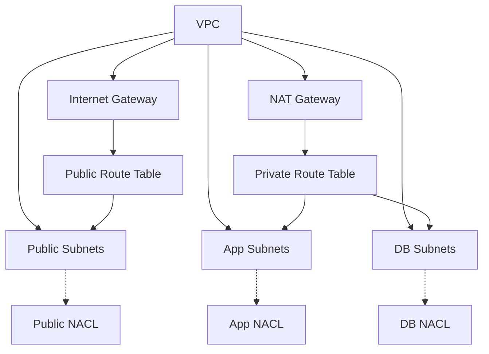

# Network Module

## Overview
This Terraform module provisions a foundational AWS network layout:

* **VPC** with DNS support/hostnames enabled.
* **Default security group** locked down (no ingress/egress) – satisfies **CKV2_AWS_12**.
* **Internet Gateway** for public internet access.
* **NAT Gateway** (regional, public) for private subnet outbound traffic.
* **Public subnets** (configurable CIDRs) – no auto‑assign public IP.
* **Private subnets** split into **app** and **db** tiers.
* **Route tables** (public → IGW, private → NAT) and **associations**.
* **Network ACLs** for public, app, and db subnets with explicit inbound/outbound rules (HTTPS, HTTP, MySQL, ephemeral ports) – stateless defense‑in‑depth.

The module is designed to be reusable across environments and projects.

## File Structure
* `vpc.tf` – VPC, default security group, internet gateway, and NAT gateway.
* `subnets.tf` – Subnet locals and public/private subnet resources.
* `route_tables.tf` – Route tables and subnet associations.
* `nacls.tf` – Network ACLs and their rules (variable-driven via `nacl_static_rules` and `nacl_dynamic_rules`).
* `variables.tf`, `outputs.tf`, and `versions.tf` – Module inputs, outputs, and version constraints.

## Usage
```hcl
module "network" {
  source = "./modules/network"

  project                    = var.project
  vpc_cidr_block             = var.vpc_cidr_block
  public_subnet_cidr_blocks  = var.public_subnet_cidr_blocks
  private_subnet_cidr_blocks = var.private_subnet_cidr_blocks
  availability_zones         = var.availability_zones

  # Optional: customize NACL rules
  # nacl_static_rules  = { ... }
  # nacl_dynamic_rules = { ... }
}
```

## Inputs
| Name | Type | Description | Default | Required |
|------|------|-------------|---------|:--------:|
| project | `string` | Project name used as prefix for all resources. | `"school-web"` | no |
| vpc_cidr_block | `string` | CIDR block for the VPC. | `"10.0.0.0/16"` | no |
| public_subnet_cidr_blocks | `list(string)` | CIDR blocks for public subnets (one per AZ). | `["10.0.1.0/24","10.0.2.0/24"]` | no |
| private_subnet_cidr_blocks | `object({app=list(string), db=list(string)})` | CIDR blocks for private subnets per tier. | — | **yes** |
| availability_zones | `list(string)` | AZ names to distribute subnets. | `["ap-southeast-1a","ap-southeast-1b"]` | no |
| nacl_static_rules | `map(list(object(...)))` | NACL rules with fixed CIDR blocks (e.g., 0.0.0.0/0) per tier. | See `variables.tf` | no |
| nacl_dynamic_rules | `map(list(object(...)))` | NACL rules that expand per-subnet CIDR (one rule per AZ). | See `variables.tf` | no |

## Outputs
| Name | Description |
|------|-------------|
| vpc_id | The ID of the created VPC. |
| internet_gateway_id | ID of the Internet Gateway. |
| nat_gateway_id | ID of the NAT Gateway. |
| public_subnet_ids | List of public subnet IDs. |
| private_subnet_ids | List of private subnet IDs (app + db). |
| subnet_ids | List of all public and private subnet IDs. |
| public_route_table_id | ID of the public route table. |
| private_route_table_id | ID of the private route table. |

## Security & Compliance
* **CKV2_AWS_12** – Default security group locked down (no ingress/egress).  
* All resources tagged with `Project`, `Environment`, `ManagedBy` for governance.  
* Private subnets have **no direct internet access**; outbound via NAT gateway.

### Network ACLs
Three stateless Network ACLs are created (public, app, db) using a single `aws_network_acl.all_tiers` resource with `for_each` over `local.tier_subnets`. Subnet associations use the actual subnet IDs:
- Public: `values(aws_subnet.public)[*].id`
- App: `[for s in aws_subnet.private : s.id if s.tags.Tier == "app"]`
- DB: `[for s in aws_subnet.private : s.id if s.tags.Tier == "db"]`

This ensures compliance with **CKV2_AWS_1**.

#### Rule Configuration
NACL rules are defined via two variable maps for maximum flexibility:

**Static Rules** (`nacl_static_rules`) – Fixed CIDR (e.g., `0.0.0.0/0`):
- Public ingress: HTTPS (443), Ephemeral (1024‑65535)
- Public egress: HTTPS (443), Ephemeral (1024‑65535)
- App egress: HTTPS (443)
- DB: (none by default)

**Dynamic Rules** (`nacl_dynamic_rules`) – One rule per AZ subnet CIDR:
- Public egress: HTTP (80) → each app subnet CIDR
- App ingress: HTTP (80) from each public subnet, Ephemeral (1024‑65535) from public & db subnets
- App egress: MySQL (3306) → each db subnet, Ephemeral (1024‑65535) → each public subnet
- DB ingress: MySQL (3306) from each app subnet
- DB egress: Ephemeral (1024‑65535) → each app subnet

Rule numbers use a base (`rule_number` in variable) plus AZ index offset (0, 1, 2…) for deterministic ordering across applies. For example, base `100` becomes `100`, `101`, `102` for three AZs.

> **Tip** – To add extra ports (e.g., TCP 8080 for a side‑car proxy), extend `nacl_static_rules` or `nacl_dynamic_rules` in your module call. Choose a free `rule_number` range; the AZ offset is applied automatically for dynamic rules.

## Default NACL Rules Summary

#### Public NACL
| Rule ID | Direction | Protocol | Port Range | CIDR | Intent |
|---------|-----------|----------|------------|------|--------|
| in_https_anywhere | ingress | tcp | 443 | 0.0.0.0/0 | Allow HTTPS from Internet |
| in_ephemeral | ingress | tcp | 1024‑65535 | 0.0.0.0/0 | Allow return traffic on ephemeral ports |
| out_https_anywhere | egress | tcp | 443 | 0.0.0.0/0 | Allow outbound HTTPS |
| out_ephemeral | egress | tcp | 1024‑65535 | 0.0.0.0/0 | Allow outbound ephemeral return traffic |
| out_http_to_app (×AZ) | egress | tcp | 80 | each app subnet CIDR | Allow HTTP to app subnets |

#### App NACL
| Rule ID | Direction | Protocol | Port Range | CIDR | Intent |
|---------|-----------|----------|------------|------|--------|
| out_https_anywhere | egress | tcp | 443 | 0.0.0.0/0 | Allow outbound HTTPS |
| in_http_from_public (×AZ) | ingress | tcp | 80 | each public subnet CIDR | Allow HTTP from public subnets |
| in_eph_from_public (×AZ) | ingress | tcp | 1024‑65535 | each public subnet CIDR | Allow ephemeral from public |
| in_eph_from_db (×AZ) | ingress | tcp | 1024‑65535 | each db subnet CIDR | Allow ephemeral from db |
| out_mysql_to_db (×AZ) | egress | tcp | 3306 | each db subnet CIDR | Allow MySQL to db |
| out_eph_to_public (×AZ) | egress | tcp | 1024‑65535 | each public subnet CIDR | Allow ephemeral to public |

#### DB NACL
| Rule ID | Direction | Protocol | Port Range | CIDR | Intent |
|---------|-----------|----------|------------|------|--------|
| in_mysql_from_app (×AZ) | ingress | tcp | 3306 | each app subnet CIDR | Allow MySQL from app |
| out_eph_to_app (×AZ) | egress | tcp | 1024‑65535 | each app subnet CIDR | Allow ephemeral to app |

*(×AZ) indicates one rule per availability zone, with rule_number = base + AZ index.*

## Dependencies
* Terraform **>= 1.17.1**  
* AWS provider **>= 6.71.0** (`hashicorp/aws`)

## Versioning
The module follows **semantic versioning**. Increment the version in the root `versions.tf` when making backward‑incompatible changes.

## Diagram (Mermaid)


---  
*Generated documentation – keep this file in sync with code changes.*