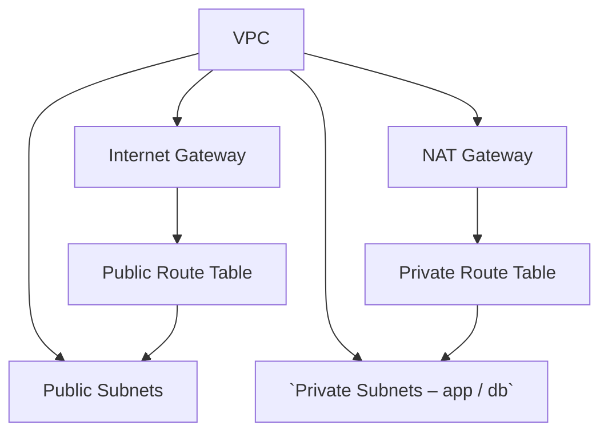

# Network Module

## Overview
This Terraform module provisions a foundational AWS network layout:

* **VPC** with DNS support/hostnames enabled.
* **Default security group** locked down (no ingress/egress) – satisfies **CKV2_AWS_12**.
* **Internet Gateway** for public internet access.
* **NAT Gateway** (regional, public) for private subnet outbound traffic.
* **Public subnets** (configurable CIDRs) – no auto‑assign public IP.
* **Private subnets** split into **app** and **db** tiers.
* **Route tables** (public → IGW, private → NAT) and **associations**.

The module is designed to be reusable across environments and projects.

## Usage
```hcl
module "network" {
  source = "./modules/network"

  project                    = var.project
  vpc_cidr_block             = var.vpc_cidr_block
  public_subnet_cidr_blocks  = var.public_subnet_cidr_blocks
  private_subnet_cidr_blocks = var.private_subnet_cidr_blocks
  availability_zones         = var.availability_zones
}
```

## Inputs
| Name | Type | Description | Default | Required |
|------|------|-------------|---------|:--------:|
| project | `string` | Project name used as prefix for all resources. | `"school-web"` | no |
| vpc_cidr_block | `string` | CIDR block for the VPC. | `"10.0.0.0/16"` | no |
| public_subnet_cidr_blocks | `list(string)` | CIDR blocks for public subnets (one per AZ). | `["10.0.1.0/24","10.0.2.0/24"]` | no |
| private_subnet_cidr_blocks | `object({app=list(string), db=list(string)})` | CIDR blocks for private subnets per tier. | — | **yes** |
| availability_zones | `list(string)` | AZ names to distribute subnets. | `["ap-southeast-1a","ap-southeast-1b"]` | no |

## Outputs
| Name | Description |
|------|-------------|
| vpc_id | The ID of the created VPC. |
| internet_gateway_id | ID of the Internet Gateway. |
| nat_gateway_id | ID of the NAT Gateway. |
| public_subnet_ids | List of public subnet IDs. |
| private_subnet_ids | List of private subnet IDs (app + db). |
| public_route_table_id | ID of the public route table. |
| private_route_table_id | ID of the private route table. |

## Security & Compliance
* **CKV2_AWS_12** – Default security group locked down (no ingress/egress).  
* All resources tagged with `Project`, `Environment`, `ManagedBy` for governance.  
* Private subnets have **no direct internet access**; outbound via NAT gateway.

## Dependencies
* Terraform **>= 1.17.1**  
* AWS provider **>= 6.71.0** (`hashicorp/aws`)

## Versioning
The module follows **semantic versioning**. Increment the version in the root `versions.tf` when making backward‑incompatible changes.

## Diagram (Mermaid)


---  
*Generated documentation – keep this file in sync with code changes.*