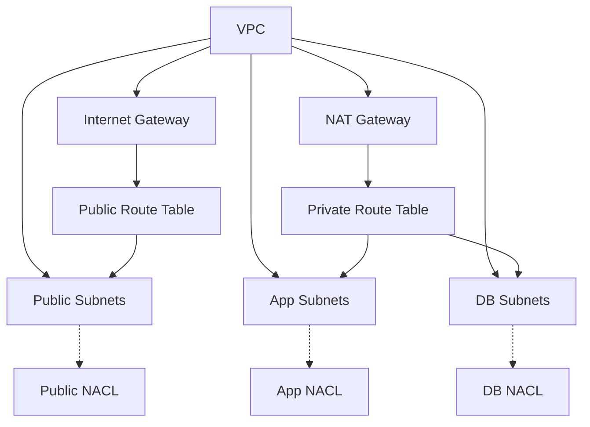

# Network Module

## Overview
This Terraform module provisions a foundational AWS network layout:

* **VPC** with DNS support/hostnames enabled.
* **Default security group** locked down (no ingress/egress) – satisfies **CKV2_AWS_12**.
* **Internet Gateway** for public internet access.
* **NAT Gateway** (regional, public) for private subnet outbound traffic.
* **Public subnets** (configurable CIDRs) – no auto‑assign public IP.
* **Private subnets** split into **app** and **db** tiers.
* **Route tables** (public → IGW, private → NAT) and **associations**.
* **Network ACLs** for public, app, and db subnets with explicit inbound/outbound rules (HTTPS, HTTP, MySQL, ephemeral ports) – stateless defense‑in‑depth.

The module is designed to be reusable across environments and projects.

## Usage
```hcl
module "network" {
  source = "./modules/network"

  project                    = var.project
  vpc_cidr_block             = var.vpc_cidr_block
  public_subnet_cidr_blocks  = var.public_subnet_cidr_blocks
  private_subnet_cidr_blocks = var.private_subnet_cidr_blocks
  availability_zones         = var.availability_zones
}
```

## Inputs
| Name | Type | Description | Default | Required |
|------|------|-------------|---------|:--------:|
| project | `string` | Project name used as prefix for all resources. | `"school-web"` | no |
| vpc_cidr_block | `string` | CIDR block for the VPC. | `"10.0.0.0/16"` | no |
| public_subnet_cidr_blocks | `list(string)` | CIDR blocks for public subnets (one per AZ). | `["10.0.1.0/24","10.0.2.0/24"]` | no |
| private_subnet_cidr_blocks | `object({app=list(string), db=list(string)})` | CIDR blocks for private subnets per tier. | — | **yes** |
| availability_zones | `list(string)` | AZ names to distribute subnets. | `["ap-southeast-1a","ap-southeast-1b"]` | no |

## Outputs
| Name | Description |
|------|-------------|
| vpc_id | The ID of the created VPC. |
| internet_gateway_id | ID of the Internet Gateway. |
| nat_gateway_id | ID of the NAT Gateway. |
| public_subnet_ids | List of public subnet IDs. |
| private_subnet_ids | List of private subnet IDs (app + db). |
| public_route_table_id | ID of the public route table. |
| private_route_table_id | ID of the private route table. |

## Security & Compliance
* **CKV2_AWS_12** – Default security group locked down (no ingress/egress).  
* All resources tagged with `Project`, `Environment`, `ManagedBy` for governance.  
* Private subnets have **no direct internet access**; outbound via NAT gateway.

### Network ACLs
Three stateless Network ACLs are created and attached to the corresponding subnet groups:

#### Public NACL (`aws_network_acl.public`)
| Rule (resource) | Direction | Protocol | Port range | CIDR | Intent |
|-----------------|-----------|----------|------------|------|--------|
| `public_in_https_from_anywhere` | ingress | tcp | 443 | 0.0.0.0/0 | Allow HTTPS from Internet to public subnets (e.g., CloudFront → ALB) |
| `public_in_ephemeral_from_anywhere` | ingress | tcp | 1024‑65535 | 0.0.0.0/0 | Allow return traffic on ephemeral ports |
| `public_out_http_to_app` | egress | tcp | 80 | each app subnet CIDR | Allow HTTP from public subnets to app subnets (ALB → App) |
| `public_out_https_to_anywhere` | egress | tcp | 443 | 0.0.0.0/0 | Allow outbound HTTPS from public subnets (e.g., NAT GW → Internet) |
| `public_out_ephemeral_to_anywhere` | egress | tcp | 1024‑65535 | 0.0.0.0/0 | Allow outbound ephemeral return traffic |

#### App NACL (`aws_network_acl.app`)
| Rule (resource) | Direction | Protocol | Port range | CIDR | Intent |
|-----------------|-----------|----------|------------|------|--------|
| `app_in_http_from_public` | ingress | tcp | 80 | each public subnet CIDR | Allow HTTP from public subnets (ALB → App) |
| `app_in_ephemeral_from_public` | ingress | tcp | 1024‑65535 | each public subnet CIDR | Allow ephemeral return traffic from public subnets |
| `app_in_ephemeral_from_db` | ingress | tcp | 1024‑65535 | each db subnet CIDR | Allow ephemeral traffic from db subnets |
| `app_out_https_to_anywhere` | egress | tcp | 443 | 0.0.0.0/0 | Allow outbound HTTPS (App → NAT GW → Internet) |
| `app_out_mysql_to_db` | egress | tcp | 3306 | each db subnet CIDR | Allow MySQL from app to db subnets |
| `app_out_ephemeral_to_public` | egress | tcp | 1024‑65535 | each public subnet CIDR | Allow ephemeral return traffic to public subnets |

#### DB NACL (`aws_network_acl.db`)
| Rule (resource) | Direction | Protocol | Port range | CIDR | Intent |
|-----------------|-----------|----------|------------|------|--------|
| `db_in_mysql_from_app` | ingress | tcp | 3306 | each app subnet CIDR | Allow MySQL from app subnets |
| `db_out_ephemeral_to_app` | egress | tcp | 1024‑65535 | each app subnet CIDR | Allow ephemeral return traffic to app subnets |

*Rule numbers are generated deterministically (`100 + index(...)`) so ordering is stable across applies. CIDR sources/destinations are driven by the same `local.*_subnets` maps used for subnet creation, ensuring automatic updates when CIDR blocks change.*

> **Tip** – To add extra ports (e.g., TCP 8080 for a side‑car proxy) extend the `local.app_subnets` / `local.db_subnets` maps or create a new `aws_network_acl_rule` resource that references the same `aws_network_acl.app` / `aws_network_acl.db` IDs. Rule numbers are auto‑calculated, so you only need to choose a free `rule_number` range.

## Dependencies
* Terraform **>= 1.17.1**  
* AWS provider **>= 6.71.0** (`hashicorp/aws`)

## Versioning
The module follows **semantic versioning**. Increment the version in the root `versions.tf` when making backward‑incompatible changes.

## Diagram (Mermaid)


---  
*Generated documentation – keep this file in sync with code changes.*